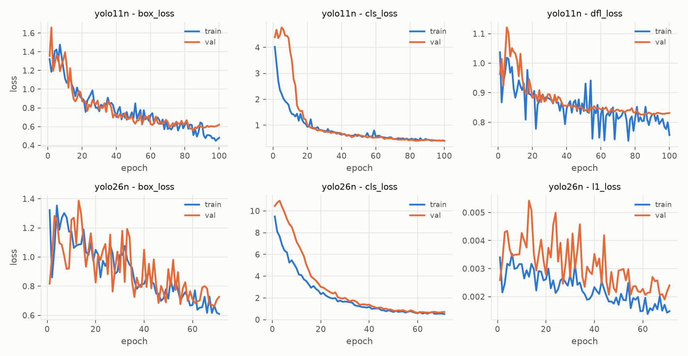
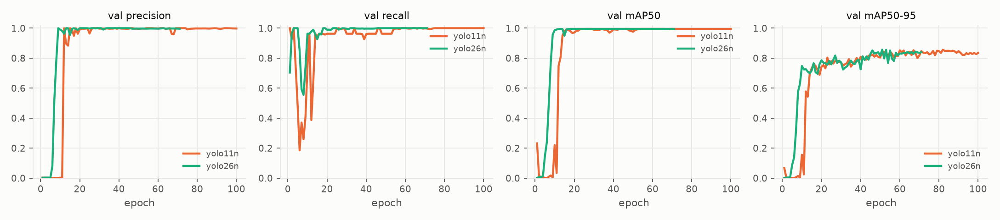
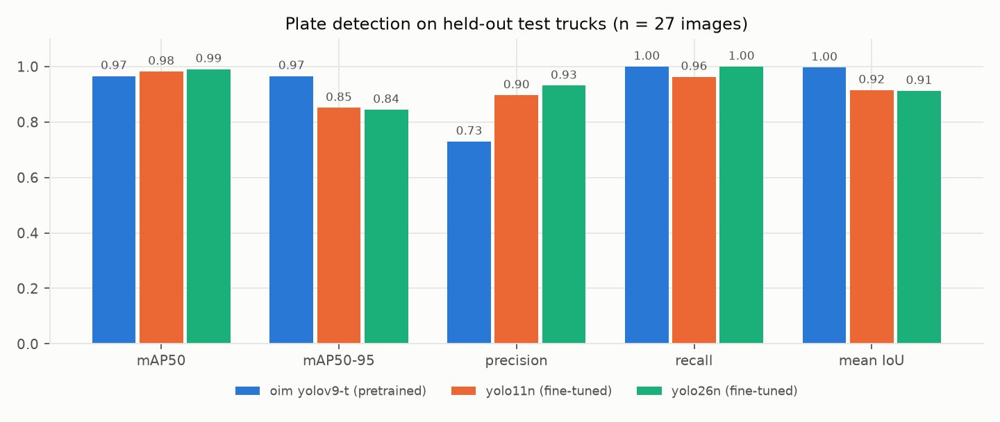
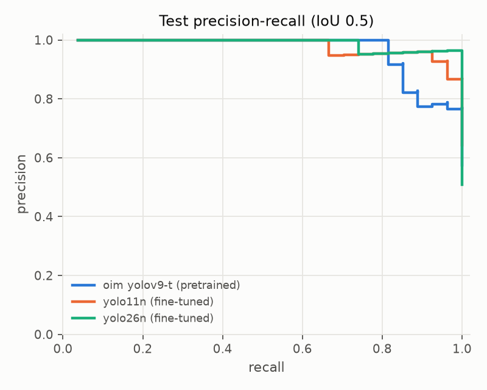

# Plate detection results (Task 3.2)

Generated by `python -m src.cv.eval_detector` on 2026-10-05. Numbers only, no photos.

## Data

Split by truck (plate text), seed 42. No truck is in more than one split.

| split | images | trucks |
|---|---|---|
| train | 129 | 101 |
| val | 27 | 14 |
| test | 27 | 20 |

## Test results (operating threshold conf >= 0.25, IoU 0.5)

| model | mAP50 | mAP50-95 | precision | recall | mean IoU | missed / false pos. | CPU ms/img (median / p95) | MPS ms/img |
|---|---|---|---|---|---|---|---|---|
| oim yolov9-t (pretrained) | 0.966 | 0.966 | 0.730 | 1.000 | 0.997 | 0 / 10 | 57.4 / 61.4 | - |
| yolo11n (fine-tuned) | 0.982 | 0.851 | 0.897 | 0.963 | 0.915 | 1 / 3 | 38.5 / 41.4 | 25.9 |
| yolo26n (fine-tuned) | 0.991 | 0.844 | 0.931 | 1.000 | 0.912 | 0 / 2 | 38.5 / 54.9 | 21.5 |

- **mean IoU** = average IoU of correct detections. `mean_best_iou` in the JSON also counts misses as 0.
- **ms/img** = image load + preprocessing + model + postprocessing, after warm-up, on: macOS-26.5.2-arm64-arm-64bit, torch 2.14.1.

## Cross-check with Ultralytics `model.val(split='test')`

| model | mAP50 | mAP50-95 | precision | recall |
|---|---|---|---|---|
| yolo11n (fine-tuned) | 0.974 | 0.829 | 0.923 | 0.963 |
| yolo26n (fine-tuned) | 0.986 | 0.836 | 0.964 | 0.993 |

Small differences from the table above are expected: Ultralytics picks its own precision/recall operating point and uses its own matching details.

## Caveats (say these on the slide)

- Small test set: 27 images of 20 trucks. One image changes recall by several points.
- The baseline is favored: ground-truth boxes started as this model's pre-labels (D-025) and were corrected by hand, so its IoU / mAP50-95 are likely optimistic.
- Every labeled photo has exactly one plate; multi-truck scenes are not tested.
- Not yet tested on the unseen `photos_new` set (D-027).

## Charts

