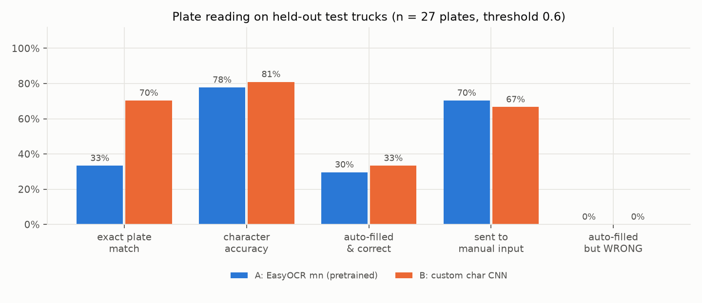
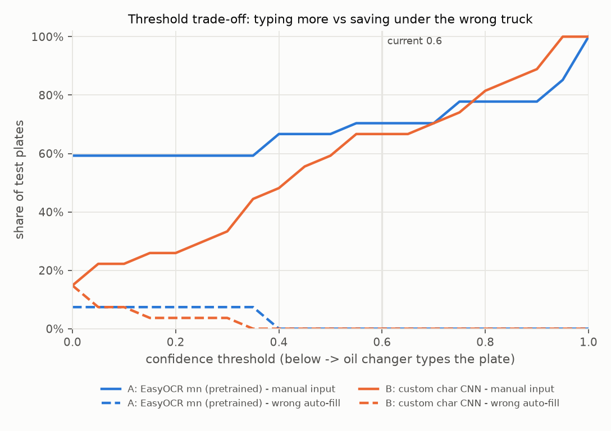

# Plate recognition results (Task 3.3)

Generated by `python -m src.cv.eval_ocr` on 2026-10-06. Numbers and single characters only, no photos or plates.

## Setup

- Test = 27 plates of 20 held-out trucks (same truck-grouped split as detection, D-009). Crops come from the production detector yolo26n (D-028), not from hand-drawn boxes.
- **A** = EasyOCR 1.7.2, language `mn` (loads the `cyrillic_g2` model; its alphabet contains Ө and Ү — checked in the package's `config.py`, not assumed). No training on our data. Allowlist = digits + the 21 letters seen on our plates.
- **B** = our CNN: connected-component segmentation into 7 characters (handles 1-row and 2-row plates) → 32×32 character classifier (291,327 parameters, 1155.8 KB), trained from scratch on train-split characters only, best epoch picked on val. Position rule: slots 1–4 digits, 5–7 letters.
- Both outputs go through the app's own `read_plate()` (normalize → format check → confidence threshold).

## Test results (threshold 0.6)

| approach | exact plate match | character accuracy | auto-filled & correct | sent to manual | auto-filled but WRONG | CPU ms/plate (median / p95) |
|---|---|---|---|---|---|---|
| A: EasyOCR mn (pretrained) | 33.3% (9/27) | 77.8% | 8/27 | 19/27 | 0/27 | 50.0 / 107.1 |
| B: custom char CNN | 70.4% (19/27) | 81.0% | 9/27 | 18/27 | 0/27 | 3.5 / 10.0 |

Paired on the same plates (exact match): both right 6, only A 3, only B 13, both wrong 5; exact McNemar p = 0.021.

- **exact plate match** = all 7 characters right, whatever the confidence.
- **character accuracy** = 1 − edit distance / 7 (a dropped character costs 1, not 7).
- **auto-filled but WRONG** = confident but wrong: the costly case (service saved under another truck).
- ms/plate = crop → text on macOS-26.5.2-arm64-arm-64bit, torch 2.14.1; detector time not included.

Why sent to manual:

- A: EasyOCR mn (pretrained): {'invalid_format': 15, 'low_confidence': 3, 'empty': 1}
- B: custom char CNN: {'empty': 4, 'low_confidence': 14}

(`empty` = nothing read; for B this means segmentation did not find exactly 7 characters.)

## Top character confusions (true → predicted, same-length readings only)

- A: EasyOCR mn (pretrained): 7->6 x1, 6->7 x1, 7->Ө x1, 6->5 x1, 6->0 x1; wrong-length readings: 14
- B: custom char CNN: У->А x2, В->Б x1, 7->6 x1, 6->5 x1, А->У x1; wrong-length readings: 4

## Threshold trade-off

| threshold | A: EasyOCR mn (pretrained) manual / wrong auto | B: custom char CNN manual / wrong auto |
|---|---|---|
| 0.0 | 59% / 7% | 15% / 15% |
| 0.2 | 59% / 7% | 26% / 4% |
| 0.4 | 67% / 0% | 48% / 0% |
| 0.5 | 67% / 0% | 59% / 0% |
| 0.6 | 70% / 0% | 67% / 0% |
| 0.7 | 70% / 0% | 70% / 0% |
| 0.8 | 78% / 0% | 81% / 0% |
| 0.9 | 78% / 0% | 89% / 0% |

## Decision

**Chosen: B: custom char CNN.** Reasons:

1. Exact plate match 70% vs 33% on the same 27 plates (paired exact McNemar p = 0.021; unlikely to be chance).
2. Speed 3.5 vs 50.0 ms/plate on CPU (cloud host is CPU-only).
3. Wrong auto-fills at threshold 0.6: 0 vs 0.
4. Both still send most plates to manual input at 0.6 (18/27 vs 19/27): recognition HELPS the oil changer but does not replace typing yet.

Threshold: keep 0.6 for now. Lower values look better on test, but picking the threshold on the test set would be cheating, and on val the CNN gave confidences up to ~0.5 to wrong plates. Re-choose on a larger val set (photos_new).

## Size / deployability

- A: EasyOCR weights on disk (text detector + cyrillic recognizer) = 98.4 MB, plus the easyocr package and its dependencies (scipy, scikit-image, shapely ...).
- B: 1155.8 KB weights, only torch + opencv (already needed by the detector).

## Caveats (say these on the slide)

- Tiny test set: 27 plates. One plate = 3.7 percentage points. Differences of 1–2 plates are noise.
- The 21-letter alphabet (allowlist for A, classes for B) was taken from all 183 labels, test included; a letter that never appears on our plates would be impossible for both.
- B's segmentation filters were tuned on train/val crops only; test was run once.
- Lighting/dirt conditions of the test photos were not audited (photos are not opened by Claude, RISK-06); an error gallery by condition needs Ari's eyes.

## Charts

## Task 3.6 — retrain char CNN on old + new labeled photos

Generated by `python -m src.cv.ocr_extend compare` on 2026-10-16. Detector unchanged (yolo26n). Threshold 0.6 unchanged. Same trainer, same settings, seed 42.

### Data

- Character samples for training (train split, plates that segment into 7): old 784 → new 994 (+210).
- Field tests: **not run** — no field-test photos exist yet (Ari, 2026-10-16).

### Old model vs new model (test only, run once)

| test set | plates | model | exact read | auto-filled | auto-filled & correct | wrong auto-fills |
|---|---|---|---|---|---|---|
| old_test | 27 | old | 70.4% (19/27) | 33.3% (9/27) | 9/27 | 0 |
| old_test | 27 | new | 74.1% (20/27) | 51.9% (14/27) | 14/27 | 0 |
| new_test | 1 | old | 100.0% (1/1) | 0.0% (0/1) | 0/1 | 0 |
| new_test | 1 | new | 100.0% (1/1) | 100.0% (1/1) | 1/1 | 0 |

Paired exact reads (old vs new, same plates): old_test: only old 1, only new 2, McNemar p = 1.000; new_test: only old 0, only new 0, McNemar p = 1.000

- `old_test` = the same 27 test plates as Task 3.3. `new_test` = new photos of trucks already in the old test set (they stay in test; no truck is in two sets).
- auto-filled = plate filled without the oil changer typing (confidence ≥ 0.6 and valid format).

### Decision

Rule D-085, fixed before the run: keep the new model only if 0 wrong auto-fills, ≥ +3 exact reads on all test plates, and no fewer correct auto-fills.

- PASS: new wrong auto-fills = 0 (must be 0)
- FAIL: exact reads 20 -> 21 (need +3)
- PASS: auto-filled & correct 9 -> 15 (must not drop)

**Old model kept; new model NOT served.**

## Task 3.6b — augmentation + validation-only tuning (char CNN v3)

Generated by `python -m src.cv.ocr_tune tune` (val only) and `python -m src.cv.ocr_tune final` (test, run once) on 2026-10-16. Detector unchanged (yolo26n). Seed 42.

### Target (D-087, set before this run)

On the 27 old test plates: ≥ 18/27 (2/3) auto-filled correctly AND 0 wrong auto-fills. Only v3 can be promoted; otherwise v1 stays served (D-086).

### What was tuned, on validation only

- Validation set = **31 plates of 17 trucks** (29 segment into 7). One val plate = 3.2 points; a threshold chosen on so few plates can easily be too low for new photos.
- Field augmentation on whole train crops before segmentation: brightness/contrast (sun), blur, rotation, downscale→upscale (far plate); 4 copies per train plate.
- Grid: strength [0.0, 0.5, 1.0] × epochs [40, 60, 90]; threshold grid 0.30–0.95.
- Rule: per model, threshold = most val correct auto-fills with 0 val wrong (tie → higher threshold); best config = most val correct auto-fills (tie → higher threshold, then fewer epochs).

| config | train chars | val exact | val threshold | val correct auto | val wrong auto |
|---|---|---|---|---|---|
| strength 0.0, 40 ep | 994 | 22/31 | 0.55 | 16 | 0 |
| strength 0.0, 60 ep | 994 | 23/31 | 0.60 | 19 | 0 |
| strength 0.0, 90 ep | 994 | 23/31 | 0.85 | 15 | 0 |
| strength 0.5, 40 ep | 4823 | 24/31 | 0.95 | 10 | 0 |
| strength 0.5, 60 ep | 4823 | 24/31 | 0.90 | 18 | 0 |
| strength 0.5, 90 ep | 4823 | 24/31 | 0.95 | 8 | 0 |
| strength 1.0, 40 ep | 4403 | 23/31 | 0.75 | 8 | 0 |
| strength 1.0, 60 ep | 4403 | 23/31 | 0.80 | 4 | 0 |
| strength 1.0, 90 ep | 4403 | 23/31 | 0.70 | 17 | 0 |
| v1 (existing) | — | 21/31 | 0.55 | 11 | 0 |
| v2 (existing) | — | 23/31 | 0.60 | 19 | 0 |

**Chosen v3: strength 0.0, 60 epochs, threshold 0.60.**

### Test (run once)

| test set | model | threshold | exact read | correct auto-fills | wrong auto-fills | sent to manual |
|---|---|---|---|---|---|---|
| old_test | v1 | 0.55 | 19/27 | 9/27 | 0 | 18/27 |
| old_test | v1 | 0.60 | 19/27 | 9/27 | 0 | 18/27 |
| old_test | v2 | 0.60 | 20/27 | 14/27 | 0 | 13/27 |
| old_test | v3 | 0.60 | 20/27 | 14/27 | 0 | 13/27 |
| new_test | v1 | 0.55 | 1/1 | 0/1 | 0 | 1/1 |
| new_test | v1 | 0.60 | 1/1 | 0/1 | 0 | 1/1 |
| new_test | v2 | 0.60 | 1/1 | 1/1 | 0 | 0/1 |
| new_test | v3 | 0.60 | 1/1 | 1/1 | 0 | 0/1 |

- `old_test` = the same 27 plates as Tasks 3.3 / 3.6 (the D-087 target is on these). `new_test` = 1 new photo of an old test truck.
- Segmentation failures (`empty`) go to manual for every CNN; they cap what any retrain can reach.

Paired exact reads on old_test: v1 vs v3: only first 1, only second 2, McNemar p = 1.000; v2 vs v3: only first 0, only second 0, McNemar p = 1.000

**The val winner is the v2 recipe (strength 0, 60 epochs) and its weights are identical to v2: the v3 rows reproduce v2's known Task 3.6 test result. Its val threshold is also 0.60, so nothing changed on test.**

### Decision

- PASS: wrong auto-fills = 0 (must be 0)
- FAIL: correct auto-fills = 14/27 (need >= 18)

**v3 does not meet D-087 → v1 stays served (D-086 unchanged); v2 and v3 saved for later.**

### Gap to the target (honest reading)

- Best correct auto-fills on test = **14/27 (v2 = v3)**; target 18/27 → **4 plates short**. Wrong auto-fills stayed 0 for every model.
- Ceiling: 4 of 27 test plates do not segment into 7 characters, so no CNN retrain can auto-fill more than 23/27; the rest of the gap is low confidence on plates read correctly or not.
- Field augmentation did NOT help on val: it raised val exact reads (23 → 24/31) but made the CNN confident on its mistakes (4 wrong val auto-fills at 0.60), so the 0-wrong rule pushed its threshold to 0.70–0.95 and cut auto-fills. Next levers are segmentation (the `empty` plates) and more labeled photos, not more augmentation.
- Val is tiny (31 plates / 17 trucks): config differences of 1–3 val plates are noise, and the 0-wrong threshold has no safety margin beyond "tie → higher threshold".

### Serving change (D-065)

The auto-fill threshold is now read from `models/plate_ocr/char_cnn_version.json` (`threshold` + `served_sha256_8` of the served ONNX), so a model promoted later with a val-chosen threshold carries it; a threshold for a different file is refused. No threshold in the file → 0.6 (D-044 default). Today nothing changes: v1 is served at 0.6.

## Task 3.6d — override: char CNN v2 served (D-097)

**This is an explicit product override by Ari, not a rule pass.** v2 did NOT meet the pre-registered rules: D-085 (needs ≥ 3 more exact reads than v1 on test; v2 has +1) and D-087 (needs ≥ 18/27 correct auto-fills; v2 has 14/27). Reason for serving it anyway: on the same test run (Task 3.6b, `final_3_6b.json`) v2 is ≥ v1 on every accuracy metric and made 0 wrong auto-fills, so it only moves plates from "type it by hand" to "correct auto-fill".

| old_test, 27 plates, threshold 0.60 | v1 | v2 |
|---|---|---|
| exact reads | 19/27 | 20/27 |
| char accuracy | 0.810 | 0.815 |
| correct auto-fills | 9/27 | **14/27** |
| wrong auto-fills | 0 | 0 |
| sent to manual | 18/27 | 13/27 |
| length errors (segmentation) | 4 | 4 |

new_test (1 plate): both read it; v2 auto-fills it, v1 sends it to manual. Latency is the same (median 2.7 vs 2.9 ms per plate; noise).

Caveats: exact reads v1 vs v2 differ on 3 plates (v1 only 1, v2 only 2, McNemar p = 1.0), so "v2 reads better" is not significant; the auto-fill gain (+5) comes mostly from v2 being more confident on plates both read. 0 wrong auto-fills on 27 plates does not prove 0 wrong in the field; staff still see and can edit every pre-filled plate.

Serving: `models/plate_ocr/char_cnn.onnx` = v2 (sha256_8 `ebd12a4c`); `char_cnn_version.json` has `threshold 0.60` (v2's val threshold, 3.6b) + `served_sha256_8`, which the API checks at start-up. v1 kept as `char_cnn_v1.onnx/.pt` (`e057fa9d`) + `char_cnn_version_v1.json` for rollback.
