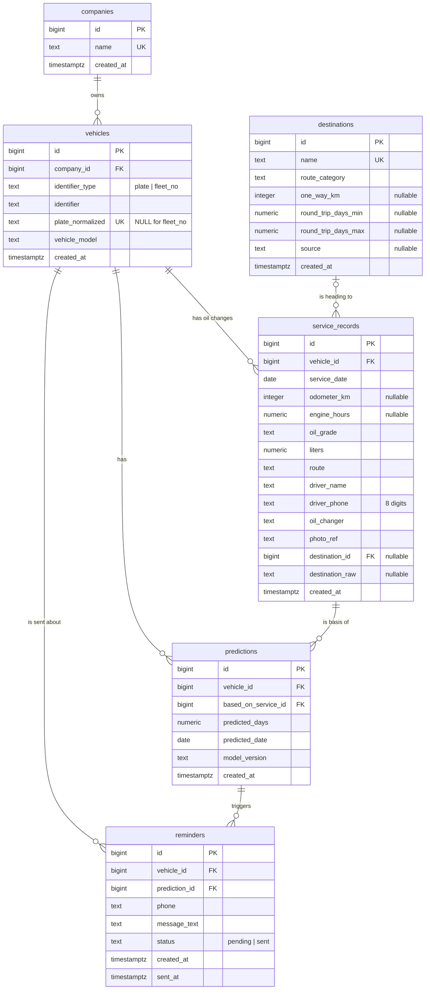

# Data Dictionary — Oil Change Predictor

- **Version:** 0.2 (Task 1.1b) · **Owner:** Data Engineer · **Date:** 2026-10-06
- **Schema file:** [`src/data/schema.sql`](../src/data/schema.sql) (PostgreSQL 16)
  + migrations in [`src/data/migrations/`](../src/data/migrations/) (§8)
- **This file is a contract.** Backend (SQLAlchemy models), ML (features) and
  Frontend (forms) build on these names. Changes are logged in §7.

**Source** column legend: **app** = entered by the oil changer in the app ·
**system** = generated by the database/API · **model** = ML model output ·
**real** = imported from Geo-Expert's existing records (task 1.4) ·
**synthetic** = from the generator (task 1.3). Every business column can come
from app, real, or synthetic data; the generator must produce the same columns.

---

## 1. ER diagram



## 2. Tables

### 2.1 `companies` — the customer (fleet owner)

| Column | Type | Null | Unit / format | Allowed values / rule | Source |
|---|---|---|---|---|---|
| `id` | BIGINT identity | no | — | primary key, auto | system |
| `name` | TEXT | no | — | unique, not blank. A private owner is stored as a company named after the owner, e.g. `Бат-Оргил (хувь хүн)` | app / real / synthetic |
| `created_at` | TIMESTAMPTZ | no | Asia/Ulaanbaatar | default `now()` | system |

### 2.2 `vehicles` — one truck

| Column | Type | Null | Unit / format | Allowed values / rule | Source |
|---|---|---|---|---|---|
| `id` | BIGINT identity | no | — | primary key, auto | system |
| `company_id` | BIGINT | no | — | FK → `companies.id` | app / real / synthetic |
| `identifier_type` | TEXT | no | — | `plate` or `fleet_no` (D-005) | app |
| `identifier` | TEXT | no | as confirmed by the oil changer, e.g. `1234 УБА`, `HT-12` | not blank. For `fleet_no`: unique within the company | app (from OCR + confirmation) / real / synthetic |
| `plate_normalized` | TEXT | yes | 4 digits + Cyrillic letters, no spaces, e.g. `1234УБА` | **required when `plate`, must be NULL when `fleet_no`**. Unique. Produced ONLY by `src/common/plates.py`. No format CHECK yet (open question 7) | system |
| `vehicle_model` | TEXT | yes | free text, e.g. `Howo A7` | no fixed list yet | app / real / synthetic |
| `created_at` | TIMESTAMPTZ | no | Asia/Ulaanbaatar | default `now()` | system |

### 2.3 `service_records` — one oil change

| Column | Type | Null | Unit / format | Allowed values / rule | Source |
|---|---|---|---|---|---|
| `id` | BIGINT identity | no | — | primary key, auto | system |
| `vehicle_id` | BIGINT | no | — | FK → `vehicles.id` | system |
| `service_date` | DATE | no | local date (Ulaanbaatar) | set automatically by the app | system / real / synthetic |
| `odometer_km` | INTEGER | yes | km | ≥ 0. **At least one of `odometer_km` / `engine_hours` required** | app (always entered fresh) / real / synthetic |
| `engine_hours` | NUMERIC(8,1) | yes | hours | ≥ 0. Used by mine trucks instead of km | app / real / synthetic |
| `oil_grade` | TEXT | no | e.g. `15W-40` | not blank; no fixed list yet | app (pre-filled from last service) / real / synthetic |
| `liters` | NUMERIC(5,1) | no | litres | > 0 | app (pre-filled) / real / synthetic |
| `route` | TEXT | yes | — | `ub_city`, `mn_china`, `mn_russia`, `mine_site`, `mixed`. Nullable because old real records may not have it | app (pre-filled) / real / synthetic |
| `driver_name` | TEXT | yes | free text | **personal data (RISK-06)** | app (pre-filled) / real / synthetic |
| `driver_phone` | TEXT | yes | exactly 8 digits, no `+976`, no spaces, e.g. `99110001` | CHECK `^[0-9]{8}$`. Normalized before insert. **Personal data** | app (pre-filled) / real / synthetic |
| `oil_changer` | TEXT | yes | free text | who did the service | app |
| `photo_ref` | TEXT | yes | storage key/path | reference to the photo in storage, never the image itself | system |
| `destination_id` | BIGINT | yes | — | FK → `destinations.id`. "Where are you heading next?", asked at every service (D-033). NULL for old records and for places not in the list. *Migration 001* | app / synthetic |
| `destination_raw` | TEXT | yes | free text, e.g. `Сайншанд` | not blank if given. What the driver said when the place is not in `destinations`. *Migration 001* | app |
| `created_at` | TIMESTAMPTZ | no | Asia/Ulaanbaatar | default `now()`; differs from `service_date` for late entries | system |

Driver + phone are stored here, not on the vehicle, because drivers change between trips (D-004).

### 2.3b `destinations` — where a truck goes after its oil change (migration 001, D-033, D-035)

Reference list behind the "heading next" question. Seed rows = [`docs/synthetic_rules.md`](synthetic_rules.md) §1;
values marked TO FILL there are NULL here until Ari fills them (then a new migration / UPDATE).

| Column | Type | Null | Unit / format | Allowed values / rule | Source |
|---|---|---|---|---|---|
| `id` | BIGINT identity | no | — | primary key, auto | system |
| `name` | TEXT | no | e.g. `Zamyn-Uud (MN–CN border)` | unique, not blank | synthetic_rules.md §1 |
| `route_category` | TEXT | no | — | same 5 values as `service_records.route`: `ub_city`, `mn_china`, `mn_russia`, `mine_site`, `mixed` | synthetic_rules.md §1 |
| `one_way_km` | INTEGER | yes | road km from Ulaanbaatar | > 0. NULL = not applicable (`ub_city`, `mixed`) or not known yet. **Round-trip km is not stored**: derive as 2 × `one_way_km` (ESTIMATE, synthetic_rules.md §1) | map source in `source` |
| `round_trip_days_min` | NUMERIC(5,1) | yes | days, **including waiting** (border, loading) | > 0, ≤ `round_trip_days_max` | Ari (TO FILL) |
| `round_trip_days_max` | NUMERIC(5,1) | yes | days, including waiting | > 0 | Ari (TO FILL) |
| `source` | TEXT | yes | URL | where `one_way_km` comes from (OSRM route link). NULL when there is no km | synthetic_rules.md §1 |
| `created_at` | TIMESTAMPTZ | no | Asia/Ulaanbaatar | default `now()` | system |

Used by Baseline B1 (D-035): `km_per_day = 2 × one_way_km ÷ round_trip_days`; `days = interval_km ÷ km_per_day`.
Code must read these values from the table, never hard-code them.

### 2.4 `predictions` — model output after a service

| Column | Type | Null | Unit / format | Allowed values / rule | Source |
|---|---|---|---|---|---|
| `id` | BIGINT identity | no | — | primary key, auto | system |
| `vehicle_id` | BIGINT | no | — | FK → `vehicles.id` | system |
| `based_on_service_id` | BIGINT | no | — | FK → the service record this prediction starts from; **must belong to the same vehicle** (composite FK) | system |
| `predicted_days` | NUMERIC(6,1) | no | days after that service | ≥ 0. Raw model output (target `days_to_next_change`, D-006 PROPOSED) | model |
| `predicted_date` | DATE | no | local date | service date + predicted days | model |
| `model_version` | TEXT | no | e.g. `xgb-2026-10-12` | not blank | system |
| `created_at` | TIMESTAMPTZ | no | Asia/Ulaanbaatar | default `now()` | system |

Not stored (computed at read time): `days_left`, `status` (OK / due soon / overdue, D-007 PROPOSED).

### 2.5 `reminders` — Mongolian reminder message (D-010)

| Column | Type | Null | Unit / format | Allowed values / rule | Source |
|---|---|---|---|---|---|
| `id` | BIGINT identity | no | — | primary key, auto | system |
| `vehicle_id` | BIGINT | no | — | FK → `vehicles.id` | system |
| `prediction_id` | BIGINT | no | — | FK → `predictions.id`; **must belong to the same vehicle** (composite FK) | system |
| `phone` | TEXT | no | 8 digits | CHECK `^[0-9]{8}$`. Copied from the latest service record at creation time. **Personal data** | system |
| `message_text` | TEXT | no | Mongolian text | not blank | system |
| `status` | TEXT | no | — | `pending` (default) or `sent` | system (marked by user) |
| `created_at` | TIMESTAMPTZ | no | Asia/Ulaanbaatar | default `now()` | system |
| `sent_at` | TIMESTAMPTZ | yes | Asia/Ulaanbaatar | **filled exactly when `status = 'sent'`** | system |

## 3. Computed objects (not stored)

### `v_vehicle_service_summary` (view)
One row per vehicle with ≥ 1 service.

| Column | Meaning |
|---|---|
| `vehicle_id` | vehicle |
| `service_count` | number of service records |
| `first_service_date`, `last_service_date` | first / newest service date |
| `last_service_id` | id of the newest service (ties on the same day → higher id) |
| `last_odometer_km`, `last_engine_hours`, `last_oil_grade`, `last_liters`, `last_route`, `last_driver_name`, `last_driver_phone` | fields of the newest service. Used to pre-fill the form and for the vehicle card |

### `vehicle_segments(as_of DATE = CURRENT_DATE, grace_days INTEGER = 7)` (function)
One row per vehicle with ≥ 1 service on or before `as_of`. Only services and
predictions that existed by `as_of` are used, so past dates give past answers.

| Column | Meaning |
|---|---|
| `vehicle_id` | vehicle |
| `service_count` | services on or before `as_of` |
| `last_service_date` | newest service on or before `as_of` |
| `latest_predicted_date` | predicted date of the newest prediction (NULL if none) |
| `segment` | see rules below |

Segment rules (checked top to bottom, first match wins):

| Segment | Rule | Decision |
|---|---|---|
| `at_risk` | latest `predicted_date` + `grace_days` < `as_of` AND no service after the one the prediction was based on | D-007 **PROPOSED** (7 days) |
| `new` | 1 service | §1 scope |
| `returning` | 2 services | §1 scope |
| `loyal` | 3+ services | §1 scope |

### `v_vehicle_segment` (view)
`vehicle_segments(CURRENT_DATE)`: today's segments, for the app.

## 4. Constraints summary

| Rule | Where | Error if broken |
|---|---|---|
| Plate vehicle has `plate_normalized`, fleet vehicle doesn't | `vehicles_plate_matches_type` | CheckViolation |
| One vehicle per normalized plate | `vehicles_plate_normalized_uq` | UniqueViolation |
| Fleet number unique per company | `vehicles_fleet_no_per_company_uq` | UniqueViolation |
| km or engine hours present | `service_records_has_meter` | CheckViolation |
| Phone = 8 digits | column CHECKs | CheckViolation |
| Route in the 5 values | column CHECK | CheckViolation |
| Destination exists | `service_records.destination_id` FK | ForeignKeyViolation |
| `destination_raw` not blank | column CHECK | CheckViolation |
| Destination name unique + not blank; category in the 5 route values; km > 0 | `destinations` column CHECKs / UNIQUE | Check/UniqueViolation |
| Round-trip days > 0 and min ≤ max | `destinations_days_min_le_max` + column CHECKs | CheckViolation |
| Prediction's service is the same vehicle | `predictions_service_same_vehicle_fk` | ForeignKeyViolation |
| Reminder's prediction is the same vehicle | `reminders_prediction_same_vehicle_fk` | ForeignKeyViolation |
| `sent_at` set ⇔ `status = 'sent'` | `reminders_sent_at_matches_status` | CheckViolation |

## 5. Sample data and expected query results

[`src/data/sample_data.sql`](../src/data/sample_data.sql): 4 companies, 6 vehicles,
11 service records, 4 predictions, 2 reminders. **All synthetic**, with phones in
the made-up block 99110001–99110008. Queries: [`src/data/example_queries.sql`](../src/data/example_queries.sql).
Checked automatically by `tests/test_schema.py`.

| Query | Input | Expected result |
|---|---|---|
| `lookup_by_plate` | `1234УБА` | vehicle 1, 3 services, last 2026-08-10, 15W-40, 32.0 L, driver phone 99110002 |
| `lookup_by_phone` | `99110002` | vehicles 6, 1 (the driver moved trucks) |
| `service_count_per_vehicle` | — | 1→3, 2→2, 3→1, 4→1, 5→2, 6→2 |
| `segment_per_vehicle` | as of 2026-09-30 | 1 loyal · 2 returning · 3 new · 4 at_risk · 5 returning (mine truck, engine hours) · 6 returning (was overdue but came back) |
| `segment_counts` | as of 2026-09-30 | at_risk 1 · loyal 1 · new 1 · returning 3 |

## 6. Privacy (RISK-06)

`driver_name`, `driver_phone`, `reminders.phone`, `identifier` / `plate_normalized`
(real plates) and photos behind `photo_ref` are personal data. Real values
live only in the database and `data/raw/` and are never committed. Demo and test
databases use synthetic rows only.

## 7. Change log

| Version | Date | Change |
|---|---|---|
| 0.1 | 2026-09-30 | First version (Task 1.1) |
| 0.2 | 2026-10-06 | Task 1.1b, migration 001: new table `destinations`; `service_records.destination_id`, `destination_raw` (nullable) |

## 8. Migrations

`schema.sql` = the base schema (Task 1.1). Every later change is a numbered pair in
[`src/data/migrations/`](../src/data/migrations/): `NNN_name.up.sql` (apply) and
`NNN_name.down.sql` (undo). Files contain no BEGIN/COMMIT; run them with
`--single-transaction` so a failure changes nothing.

| # | File | What |
|---|---|---|
| 001 | `001_destinations.up.sql` / `.down.sql` | `destinations` table + seed; destination columns on `service_records` |

- **New dev DB** (`docker compose down -v && docker compose up -d db`): docker-compose runs
  `schema.sql` then every up migration automatically.
- **Existing dev DB** (volume already there): run by hand
  ```bash
  docker compose exec -T db psql -U oil -d oil_change --single-transaction -v ON_ERROR_STOP=1 -f /sql/migrations/001_destinations.up.sql
  # undo:
  docker compose exec -T db psql -U oil -d oil_change --single-transaction -v ON_ERROR_STOP=1 -f /sql/migrations/001_destinations.down.sql
  ```
- Tested by `tests/test_migration_001_destinations.py` (up on clean + filled DB, down restores the old schema, up→down→up).
- Task 4.1 (FastAPI + SQLAlchemy) may move these into its migration tool; the SQL stays the same.
