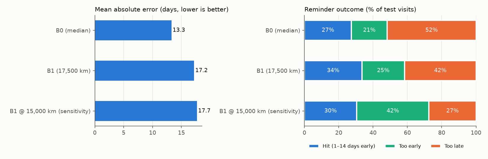

# ML baselines (Tasks 2.1–2.3a)

Generated by `python -m src.ml.baselines` from `configs/ml.yaml` (seed 42).
Data: `data/synthetic/service_records_cleaned.csv` — **SYNTHETIC** (task 1.3 generator + 1.4 cleaning), not
Geo-Expert's customers. Same config + data → same report.

## 1. Target and split

- Target `days_to_next_change` (D-006) = days from a visit to the same truck's next
  visit. 3,884 visits, 3,384 with a target; the other 500
  are each truck's last visit (never returned, or next visit after the data ends).
  On this synthetic file the derived target equals the generator's truth on every
  returned visit (checked in task 2.1).
- Split (D-009): 100 of 500 trucks held out
  (20%, seed 42); cutoff
  **2025-08-16** (70% quantile of service dates).
  Train = train trucks' visits whose next visit is before the cutoff; test = test
  trucks' visits on/after it. No truck is in both; nothing after the cutoff is trained on.

| Set | Trucks | Visits | Dates | Median days |
|---|---|---|---|---|
| Train | 357 | 1752 | 2024-01-02 – 2025-07-14 | 53 |
| Test | 42 | 197 | 2025-08-18 – 2026-09-01 | 52 |

## 2. Baselines

- **B0** = median train interval = **53 days** for every truck.
- **B1** = 17,500 km (D-049) ÷ route km/day. km/day = round-trip km ÷
  (driving days + waiting) with speed, hours and waiting at the middle of their
  [ESTIMATE] ranges (configs/generator.yaml). 17 of 197 test visits
  have no destination → B0 fallback.

| Destination | Route | One-way km | km/day (all ranges at middle) | B1 days at 17,500 km | Test: actual median days |
|---|---|---|---|---|---|
| Zamyn-Uud (MN–CN border) | mn_china | 656 | 338 | 52 | 51 |
| Erenhot (CN side of border) | mn_china | 668 | 342 | 51 | 59 |
| Beijing | mn_china | 1,330 | 502 | 35 | 44 |
| Altanbulag (MN–RU border) | mn_russia | 345 | 214 | 82 | 54 |
| Kyakhta (RU side of border) | mn_russia | 351 | 217 | 81 | 76 |
| Ganqimaodu (CN side of Gashuunsukhait border) | mn_china | 247 | 164 | 107 | 64 |
| Ceke (CN side of Shiveekhuren border) | mn_china | 928 | 417 | 42 | 52 |
| Ulan-Ude (via Altanbulag–Kyakhta) | mn_russia | 578 | 311 | 56 | 50 |
| Kosh-Agach (via Tsagaannuur–Tashanta) | mn_russia | 1,786 | 571 | 31 | 44 |

## 3. Results on the test split (197 visits, 42 trucks)

| Baseline | RMSE (days) | MAE (days) | R² | Reminder hit rate | Too early | Too late |
|---|---|---|---|---|---|---|
| B0 (median) | 16.9 | 13.3 | -0.01 | 27.4% | 20.8% | 51.8% |
| B1 (17,500 km) | 22.2 | 17.2 | -0.76 | 33.5% | 24.9% | 41.6% |
| B1 @ 15,000 km (sensitivity) | 22.0 | 17.7 | -0.73 | 30.5% | 42.1% | 27.4% |

Reminder: sent on the predicted day − 0 buffer days. **Hit** =
it arrives 1–14 days before the actual visit (D-036; window [ESTIMATE],
Ari to confirm). **Too late** is the worse miss (truck may already be overdue).

The `B1 @ … km` rows are a sensitivity check only (fixed in configs/ml.yaml from D-030 /
D-049), not the official B1, and were not chosen by looking at the test scores.

## 4. Reading

- Both baselines predict one number per truck type at best, so they cannot follow a
  truck's own pace or lateness. Their hit rate is the bar the ML model (2.3b) must clear.
- **B1 is worse than B0.** The table in §2 shows why: B1's days differ a lot by
  destination (e.g. Beijing vs the Russian border), but the actual medians barely do.
  A truck's stated destination fixes only its next trip; it often changes route
  before the next oil change (V6), and waiting days matter as much as distance
  (D-047, docs/synthetic_report.md §3). B1 also has no notion of lateness:
  ~40 % of visits come after 20,000 km (D-031). This is a finding about the SYNTHETIC rules; real
  routes may behave differently.
- Test has 197 visits: differences of about 1 day MAE or a few % hit rate
  are within noise. Only 42 of the 100 held-out trucks have a visit
  after the cutoff: the rest stopped coming earlier (the generator's "never returns",
  D-031). All test trucks already have history (first services are in the
  first year), so the first-visit fallback is not exercised by this split.
- Visits near the end of the data only have a target if the truck came back soon,
  so long intervals are slightly under-represented in test (same for every model).
