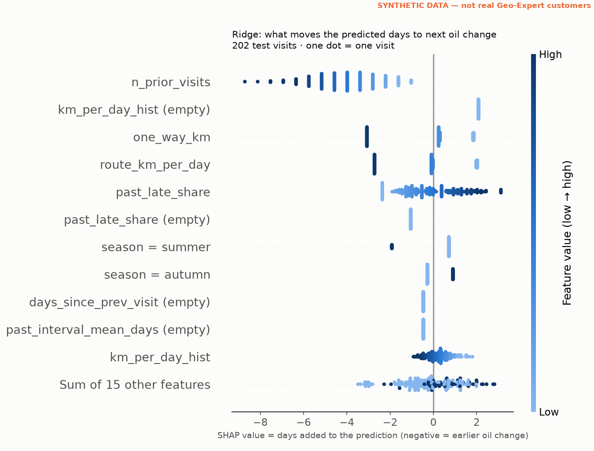
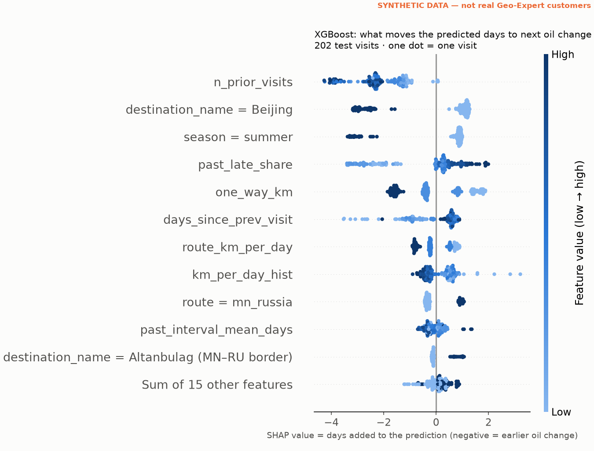
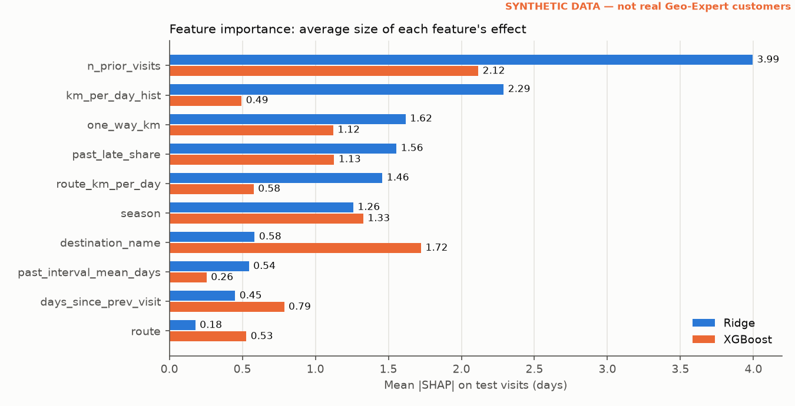
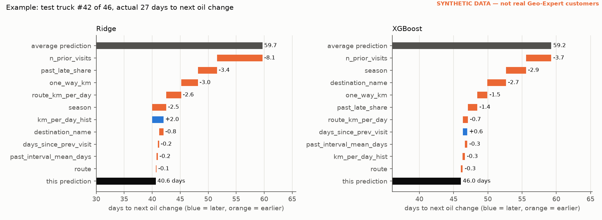
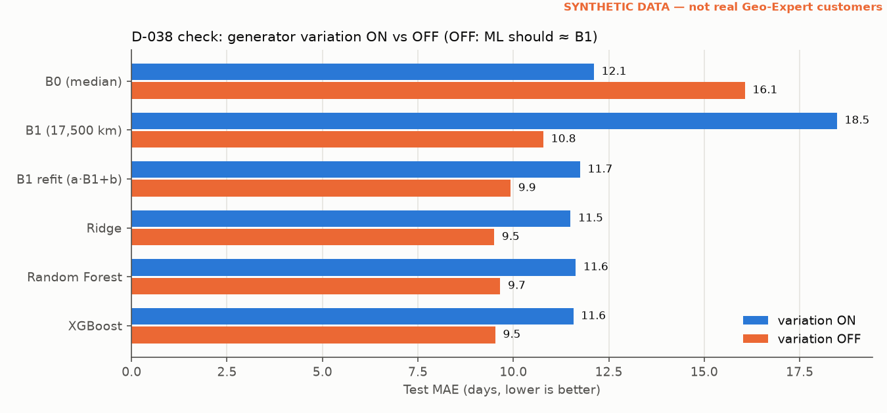
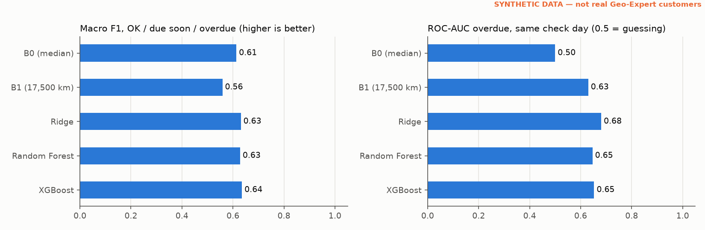
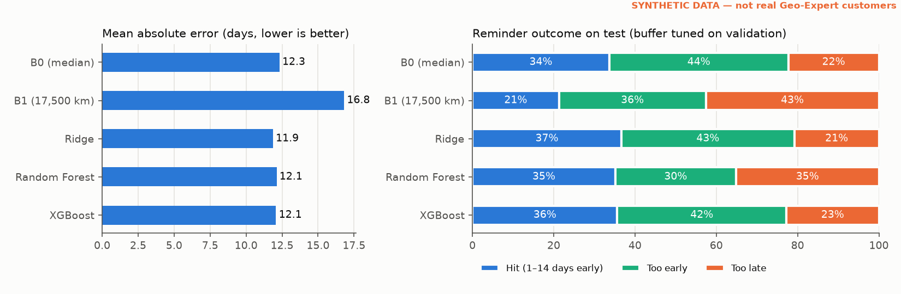

# ML evaluation + explanation (Task 2.4)

Generated by `python -m src.ml.evaluate` from `configs/ml.yaml` (seed 42).
**All numbers are on SYNTHETIC data** (generator task 1.3 + cleaning task 1.4), not on
Geo-Expert's customers; every chart says so. Real-record test: later (1.4b intervals, D-050).

Main run = same data and split as docs/ml_results.md (`make_split`: cutoff
2025-08-23; train 1,745 visits / 359 trucks, test
202 visits / 46 trucks; no truck in both). Hyperparameters, best model and
every reminder buffer are chosen on TRAIN out-of-fold predictions (GroupKFold by truck); test is
only scored. Model choice on validation MAE: **XGBoost**. Serving model (PROJECT_STATE v2.1):
**Ridge**.

## 1. SHAP — what the models use (Ridge = linear, XGBoost = tree)

SHAP value = days a feature adds to (or removes from) one prediction, compared with the model's
average prediction. Base value + all SHAP values = the prediction (checked: largest error
Ridge 7.1e-15 days, XGBoost 5.1e-05 days). Explained rows = the
202 test visits. Ridge: `shap.LinearExplainer`, train rows as background
(SHAP = coefficient × (value − train mean)); XGBoost: `shap.TreeExplainer`.

Importance per original feature (mean |SHAP|, days; one-hot columns and "was empty" flags summed
into their feature):

| Feature | Ridge | XGBoost |
|---|---|---|
| n_prior_visits | 3.99 | 2.12 |
| km_per_day_hist | 2.29 | 0.49 |
| one_way_km | 1.62 | 1.12 |
| past_late_share | 1.56 | 1.13 |
| route_km_per_day | 1.46 | 0.58 |
| season | 1.26 | 1.33 |
| destination_name | 0.58 | 1.72 |
| past_interval_mean_days | 0.54 | 0.26 |
| days_since_prev_visit | 0.45 | 0.79 |
| route | 0.18 | 0.53 |

**Example truck** (test truck #42 of 46; chosen as the visit, among trucks with ≥
2 earlier visits, where Ridge moves furthest from its average — chosen from
predictions only, not from the actual answer):

| Item | Value |
|---|---|
| destination_name | Beijing |
| route | mn_china |
| season | summer |
| one_way_km | 1330.00 |
| route_km_per_day | 501.89 |
| n_prior_visits | 16 |
| days_since_prev_visit | 67.00 |
| past_interval_mean_days | 51.00 |
| km_per_day_hist | 346.32 |
| past_late_share | 0.00 |
| prediction: B0 (median) | 58.0 days |
| prediction: B1 (17,500 km) | 34.9 days |
| prediction: Ridge | 40.6 days |
| prediction: Random Forest | 49.7 days |
| prediction: XGBoost | 46.0 days |
| actual days to next oil change | 27 |

**Reading.**
- Both models put most weight on the truck's history (`n_prior_visits`, `km_per_day_hist`,
  `past_late_share`) and on the route (`one_way_km`, `route_km_per_day`, destination). Effects
  are small: the largest feature moves a prediction by ~4 days on average,
  against a test MAE of ~12 days — consistent with ML ≈ B0 (docs/ml_results.md).
- Ridge (linear) uses the pace from the odometer (`km_per_day_hist`) much more than XGBoost; XGBoost
  spreads its weight more over destination and season. Same data, different shapes of model.
- **Warning about the top feature, `n_prior_visits` (more visits → shorter prediction).** On TRAIN it
  correlates +0.68 with the service date and -0.11 with the target. In the generator's
  truth the number of visits is unrelated to a truck's real pace (r = +0.039) or lateness
  (r = +0.004). Median target by service-date quarter of TRAIN: Q1 (earliest) 58, Q2 58, Q3 60, Q4 (latest) 55.
  So the feature mostly tells the model *how late in the data window* a visit is: visits shortly
  before the split cutoff are only in TRAIN if their next visit came quickly (right-censoring), and
  the same happens near the end of the data for test. This is a property of how the data window is
  cut, not of the truck. **In real use it would shorten predictions for loyal trucks for no reason.**
  Fix proposal for PM (not done here, features.py is outside this brief): drop it or replace it with
  a 0/1 "has history" flag, and retrain.

## 2. D-038 check: generator variation OFF → ML must ≈ B1

Separate run, nothing in configs/generator.yaml changed: the generator's own D-038 switch
`variation.enabled` is set to false on an in-memory copy (V1 speed/hours per truck, V2 trip
noise, V5 per-truck lateness, V6 route switching off). Still on in both runs: on-time km
15k–20k, 40 % late visits, waiting 0–5 days per trip, season factor V3. Both runs use the
generator's clean records (no noise/cleaning step) so ON vs OFF differ ONLY by variation; same
features, split function, search and buffers as the main run.

`B1 refit (a·B1+b)` = B1 with a straight line fitted on TRAIN (removes B1's average offset, e.g. from late
visits, which B1 by design does not include). It is the fair "route formula" reference: an ML model
that only learned the route formula should land here.

**Needs a look.** Rule: with variation OFF, the best model must not beat the calibrated route formula by more than 0.5 days MAE. Result: Ridge gain = +0.43 days (95% interval +0.18 to +0.71) — the upper end is above the tolerance.

Variation **ON** (train 1,721 / test 178 visits, 41 test trucks; best on validation XGBoost):

| Predictor | RMSE | MAE | R² |
|---|---|---|---|
| B0 (median) | 15.7 | 12.1 | -0.02 |
| B1 (17,500 km) | 22.2 | 18.5 | -1.04 |
| B1 refit (a·B1+b) | 15.3 | 11.7 | 0.03 |
| Ridge | 15.0 | 11.5 | 0.07 |
| Random Forest | 14.9 | 11.6 | 0.08 |
| XGBoost | 14.9 | 11.6 | 0.08 |

Variation **OFF** (train 1,598 / test 181 visits, 44 test trucks; best on validation Ridge):

| Predictor | RMSE | MAE | R² |
|---|---|---|---|
| B0 (median) | 20.7 | 16.1 | -0.06 |
| B1 (17,500 km) | 14.8 | 10.8 | 0.46 |
| B1 refit (a·B1+b) | 12.8 | 9.9 | 0.59 |
| Ridge | 12.4 | 9.5 | 0.62 |
| Random Forest | 12.5 | 9.7 | 0.61 |
| XGBoost | 12.4 | 9.5 | 0.62 |

MAE gain vs B1, variation OFF (positive = better than B1; 95% interval, whole test trucks resampled):

| vs B1 | MAE gain (days) | 95% interval | Result |
|---|---|---|---|
| B1 refit (a·B1+b) | +0.86 | -0.17 to +1.89 | ≈ (interval includes 0) |
| Ridge | +1.29 | +0.29 to +2.26 | better |
| Random Forest | +1.13 | +0.10 to +2.15 | better |
| XGBoost | +1.26 | +0.21 to +2.29 | better |

MAE gain vs B1 refit (a·B1+b):

| Run | Ridge | Random Forest | XGBoost |
|---|---|---|---|
| variation ON | +0.25 (-0.17 to +0.73) | +0.11 (-0.36 to +0.59) | +0.18 (-0.34 to +0.71) |
| variation OFF | +0.43 (+0.18 to +0.71) | +0.27 (+0.12 to +0.42) | +0.40 (+0.15 to +0.66) |

**What explains the gap?** A model that only knew the route formula should land on `B1 refit (a·B1+b)`.
The ML models also see three things B1 does not: the season (V3 stays on in both runs), a
separate average per destination (the late-visit offset is the same number of days for every
route, which a·B1+b cannot fit), and `n_prior_visits` (calendar/censoring proxy, §1). Plain
least-squares fits on TRAIN with only those inputs (nothing tuned):

| Run | B1 refit + season | B1 refit + n_prior_visits | destination means + season + n_prior_visits |
|---|---|---|---|
| variation ON: test MAE (gain vs B1 refit) | 11.79 (-0.04, -0.32 to +0.25) | 11.93 (-0.18, -0.62 to +0.28) | 11.77 (-0.03, -0.53 to +0.53) |
| variation OFF: test MAE (gain vs B1 refit) | 9.80 (+0.13, -0.10 to +0.38) | 9.79 (+0.14, +0.00 to +0.27) | 9.64 (+0.29, +0.07 to +0.53) |

ML vs the last of these ("destination means + season + n_prior_visits"), MAE gain with 95% interval:

| Run | Ridge | Random Forest | XGBoost |
|---|---|---|---|
| variation ON | +0.27 (+0.05 to +0.52) | +0.14 (-0.39 to +0.67) | +0.20 (-0.17 to +0.56) |
| variation OFF | +0.14 (+0.03 to +0.27) | -0.02 (-0.19 to +0.14) | +0.11 (-0.05 to +0.28) |

**Reading.** If the ML gain over B1 came from leakage, a three-input linear fit could not
reproduce it. Compare the two tables: the more of the ML gain the simple fit recovers, and the
closer ML is to it (interval including 0), the less room there is for leakage. The
rule above (tolerance set before the final run, not adjusted afterwards) is kept as it came out;
this section only explains it. The visible
items B1 lacks are legitimate inputs (season, destination) plus one that is an artefact of the data
window (`n_prior_visits`, §1) — the latter is the thing to fix.

## 3. Status classes OK / due soon / overdue (D-007)

Status on day t after a service: days left = predicted date − t. **OK** > 14 days left,
**due soon** 0–14, **overdue** < 0 (D-007). True status uses the actual next visit as the
due date (the only due date we observe). Each test visit is checked every 7 days from
the service until 14 days after its actual next visit → 2,222 checks
(true classes: OK 63%, due soon 19%, overdue 18%).
Predicted date = round(prediction), as on the vehicle card (no reminder buffer).
ROC-AUC score = days past the predicted date.

| Predictor | F1 OK | F1 due soon | F1 overdue | Macro F1 | Accuracy | ROC-AUC overdue (pooled) | ROC-AUC overdue (same day) | ROC-AUC needs reminder |
|---|---|---|---|---|---|---|---|---|
| B0 (median) | 0.87 | 0.35 | 0.62 | 0.61 | 73.0% | 0.908 | 0.500 | 0.918 |
| B1 (17,500 km) | 0.81 | 0.28 | 0.59 | 0.56 | 65.9% | 0.866 | 0.630 | 0.870 |
| Ridge | 0.87 | 0.38 | 0.64 | 0.63 | 73.0% | 0.914 | 0.681 | 0.925 |
| Random Forest | 0.87 | 0.38 | 0.63 | 0.63 | 73.3% | 0.910 | 0.647 | 0.921 |
| XGBoost | 0.87 | 0.39 | 0.65 | 0.64 | 73.5% | 0.910 | 0.653 | 0.921 |

How to read the three AUCs: **pooled** mixes check days, and elapsed time alone already tells
overdue from not (B0, one number for everyone, scores high too). **Same day** compares trucks on the
same check day only, so it measures what the model knows about each truck (B0 = 0.5 exactly).
**Needs reminder** = due soon or overdue vs OK. The check protocol (every 7 days, until
+14) is an [ESTIMATE] in configs/ml.yaml; it sets the class mix and therefore the F1 values —
compare the predictors with each other, not with numbers from other projects.

## 4. Reminder hit rate, window 1–14 days early (D-051)

Window status: PROPOSED in D-051 (PROJECT_STATE v2.2), Ari to confirm.

Hit = reminder arrives 1–14 days before the actual visit; sent on predicted day − buffer.
Buffers retuned for this window on TRAIN out-of-fold predictions (range
0–30 days; ties → fewer late reminders). Window is
configurable: `reminder.window_days_early` in configs/ml.yaml.

| Baseline | Buffer (days early) | RMSE (days) | MAE (days) | R² | Reminder hit rate | Too early | Too late | Hit rate, no buffer |
|---|---|---|---|---|---|---|---|---|
| B0 (median) | 12 | 15.7 | 12.3 | -0.00 | 33.7% | 44.1% | 22.3% | 30.7% |
| B1 (17,500 km) | 1 | 20.9 | 16.8 | -0.78 | 21.3% | 36.1% | 42.6% | 22.3% |
| Ridge | 9 | 15.5 | 11.9 | 0.02 | 36.6% | 42.6% | 20.8% | 32.2% |
| Random Forest | 7 | 15.4 | 12.1 | 0.03 | 35.1% | 29.7% | 35.1% | 31.7% |
| XGBoost | 10 | 15.6 | 12.1 | 0.01 | 35.6% | 41.6% | 22.8% | 31.2% |

Hit-rate difference vs B0 on test (95% interval, whole test trucks resampled):

| vs B0 | Hit-rate gain | 95% interval |
|---|---|---|
| B1 (17,500 km) | -12.4% | -20.4% to -4.5% |
| Ridge | +3.0% | -3.9% to +9.2% |
| Random Forest | +1.5% | -5.1% to +7.5% |
| XGBoost | +2.0% | -4.4% to +8.2% |

Sensitivity: old window (D-049), buffers retuned on validation the same way:

| Window | Predictor | Buffer | Test hit rate |
|---|---|---|---|
| 3–7 days | B0 (median) | 11 | 14.9% |
| 3–7 days | B1 (17,500 km) | 4 | 8.4% |
| 3–7 days | Ridge | 9 | 14.9% |
| 3–7 days | Random Forest | 18 | 10.9% |
| 3–7 days | XGBoost | 12 | 10.9% |

## 5. Serving model

`models/next_change_model.joblib` (git-ignored) = **Ridge** pipeline + buffer 9 days (tuned for the
1–14 day window on validation) + feature list + metadata (`.json` next to it).
The API (task 4.3) loads this file and uses `src/common/features.py` for its inputs.
