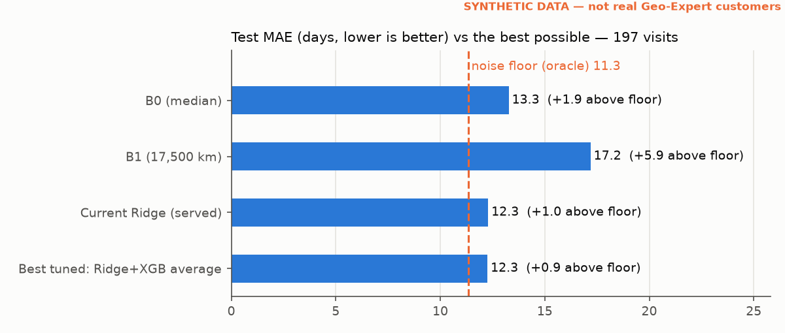

# ML results (Task 2.3b, refreshed in 2.4b)

> Model comparison only. The full evaluation (SHAP, D-038 check, status F1/AUC, reminder window)
> is docs/ml_evaluation.md; where the two overlap they come from the same split and settings.
> 2.4b: feature `n_prior_visits` replaced by `has_history` (D-058); reminder window from configs/ml.yaml.

Generated by `python -m src.ml.train` from `configs/ml.yaml` (seed 42).
Data: **SYNTHETIC** (`data/synthetic/service_records_cleaned.csv`). Same split as docs/ml_baselines.md
(`make_split`: cutoff 2025-08-16; train 1,752 visits / 357 trucks,
test 197 visits / 42 trucks; no truck in both).

## Verdict

**Ridge beats B0** on test: MAE 12.3 vs 13.3 days (gain +0.98, 95% interval +0.38 to +1.55).

## 1. B1 check: does route km/day include waiting? (brief step 1)

Yes. `route_table` → `formula_days_at_midpoints` adds the middle waiting days (2.5 per round trip) to the middle driving days, exactly like the generator adds waiting to every trip. Checked against the generator itself (its own `draw_trip` / `simulate_interval`, 4,000 trips and 3,000 on-time intervals per destination, no records): per-trip km/day agrees within ~3 % (Beijing 502 formula vs 486 generator), and with route switching (V6) turned off, B1 at 17,500 km equals the generator's median on-time interval (Beijing 35 = 35, Kyakhta 81 = 81). **Not a bug.** The Beijing gap (B1 35 vs actual ~54 days) comes from V6: a truck changes route between oil changes, so every destination drifts toward the fleet average (Beijing 35 → 44, Russian border 82 → 57 with V6 on), plus late visits on top. Official B1 switched to 17,500 km (D-049).

## 2. How the models were chosen (TRAIN only)

- Features: `src/common/features.py` (10 columns; vehicle model and oil grade not used).
  Categories one-hot; numbers median-filled with "was empty" flags (fitted inside each fold).
- RandomizedSearchCV, 25 draws per model, GroupKFold(5) by truck, scored by MAE.
- Validation = out-of-fold predictions on TRAIN (each visit predicted without its truck).
  **Best model = lowest validation MAE → Ridge.** Test was not looked at for this choice.
- Reminder buffer per model (B0 and B1 too) = days early that maximize the validation hit
  rate (range 0–30 days; ties → fewer late reminders).

| Model | CV MAE (train) | Best hyperparameters |
|---|---|---|
| Ridge | 12.46 | alpha=157 |
| Random Forest | 12.55 | max_depth=12, max_features=0.3, min_samples_leaf=43, n_estimators=321 |
| XGBoost | 12.54 | colsample_bytree=0.901, learning_rate=0.0125, max_depth=2, min_child_weight=24, n_estimators=228, reg_lambda=0.25, subsample=0.602 |

Validation (TRAIN, out-of-fold):

| Baseline | Buffer (days early) | RMSE (days) | MAE (days) | R² | Reminder hit rate | Too early | Too late |
|---|---|---|---|---|---|---|---|
| B0 (median) | 13 | 16.6 | 13.2 | -0.01 | 33.3% | 45.2% | 21.5% |
| B1 (17,500 km) | 4 | 23.3 | 17.8 | -1.00 | 30.2% | 33.8% | 36.0% |
| Ridge | 16 | 15.6 | 12.5 | 0.11 | 37.8% | 47.7% | 14.5% |
| Random Forest | 16 | 15.6 | 12.6 | 0.10 | 37.7% | 47.4% | 14.8% |
| XGBoost | 16 | 15.6 | 12.5 | 0.10 | 37.4% | 47.4% | 15.2% |

## 3. Results on the test split (197 visits, 42 trucks)

| Baseline | Buffer (days early) | RMSE (days) | MAE (days) | R² | Reminder hit rate | Too early | Too late | Hit rate, no buffer |
|---|---|---|---|---|---|---|---|---|
| B0 (median) | 13 | 16.9 | 13.3 | -0.01 | 35.5% | 45.2% | 19.3% | 27.4% |
| B1 (17,500 km) | 4 | 22.2 | 17.2 | -0.76 | 30.5% | 36.0% | 33.5% | 33.5% |
| Ridge | 16 | 15.6 | 12.3 | 0.14 | 38.6% | 49.2% | 12.2% | 25.4% |
| Random Forest | 16 | 15.7 | 12.4 | 0.13 | 40.1% | 48.2% | 11.7% | 22.8% |
| XGBoost | 16 | 15.7 | 12.5 | 0.13 | 40.6% | 47.2% | 12.2% | 22.8% |

Hit = reminder arrives 1–14 days before the actual visit (D-036; window D-051, configs/ml.yaml),
sent on predicted day − buffer. "Hit rate, no buffer" = same prediction sent on the predicted day.

**MAE difference vs B0 on test** (positive = better than B0; 95% interval from
2,000 resamples of whole test trucks):

| vs B0 | MAE gain (days) | 95% interval | Clearly better than B0? |
|---|---|---|---|
| B1 (17,500 km) | -3.91 | -6.38 to -1.57 | worse |
| Ridge | +0.98 | +0.38 to +1.55 | yes |
| Random Forest | +0.86 | +0.29 to +1.42 | yes |
| XGBoost | +0.81 | +0.24 to +1.39 | yes |

## 4. Reading

- Best model on validation: **Ridge** (validation MAE 12.46 vs B0 13.16).
- On this synthetic data the truck's history features are weak (|r| ≤ 0.16, task 2.1),
  so a large gain over a fixed interval was not expected (RISK-13). Per D-050 the generator
  was NOT changed to make ML win; the next step is calibrating it to the real repeat-truck
  intervals (1.4b) and reporting before/after.
- The buffer matters as much as the model for the business metric: compare "Hit rate,
  no buffer" with the tuned column.
- Test has 197 visits from 42 trucks; read small differences with the intervals above.
- Saved: `models/next_change_model.joblib` (git-ignored) = Ridge pipeline (serving model,
  `models.serving_model` in configs/ml.yaml) + its buffer (16 days) + feature list.
  SHAP and the full evaluation: docs/ml_evaluation.md (task 2.4).

<!-- task 2.9 start -->
## 5. Task 2.9 — noise floor, honest tuning, prediction range

Generated by `python -m src.ml.tune` (cv → test once on 2026-10-17 → report). SYNTHETIC data, same
split as above (train 1,752 visits / 357 trucks, test 197 visits /
42 trucks). Keep rule D-093, fixed before results: a new served model only if its
GroupKFold(5)-by-truck CV MAE on TRAIN beats the served model by ≥ 0.3 days.

**Noise floor (oracle).** A predictor that knows the generator's hidden truck values (speed, driving
hours, late chance), the true destination and the date, but not the random draws after the service
(on time/late, the km the driver changes at, trip noise, waiting, route switches). Its best guess for
MAE is the median of 1,000 re-simulations of `generator.simulate_interval` per visit
(src/ml/noise_floor.py; generator seed 42, not changed). No model with our features can be expected to beat it.

### 5.1 Tuning on TRAIN (GroupKFold by truck; test not used)

| Model | CV MAE (train) | Δ vs current | Parameters |
|---|---|---|---|
| Current Ridge (served) | 12.46 | — | alpha=157 |
| Ridge | 12.46 | -0.00 | alpha=300 |
| Random Forest | 12.55 | -0.09 | max_depth=10, max_features=0.3, min_samples_leaf=60 |
| XGBoost | 12.45 | +0.01 | learning_rate=0.02, max_depth=2, n_estimators=300, objective=reg:absoluteerror |
| Ridge+XGB average | 12.40 | +0.06 | ridge_weight=0.5 |
| B0 (median) | 13.16 | — | — |
| B1 (17,500 km) | 17.83 | — | — |

**Not kept — the served Ridge stays.** Best tuned = Ridge+XGB average, CV MAE 12.40 vs 12.46 (Δ +0.06 days; rule needs ≥ +0.3).

### 5.2 Test, run once

| Model | MAE (days) | RMSE (days) | Above floor (days) | MAE gain vs B0 (95% CI) |
|---|---|---|---|---|
| Oracle (noise floor) | 11.34 | 14.7 | — | +1.94 (+0.75 to +3.05) |
| B0 (median) | 13.28 | 16.9 | +1.94 | — |
| B1 (17,500 km) | 17.19 | 22.2 | +5.86 | -3.91 (-6.38 to -1.57) |
| Current Ridge (served) | 12.30 | 15.6 | +0.96 | +0.98 (+0.38 to +1.55) |
| Best tuned: Ridge+XGB average | 12.26 | 15.7 | +0.93 | +1.02 (+0.38 to +1.61) |

Best tuned vs served on test: MAE gain +0.03 (-0.15 to +0.23) days (95% CI, whole trucks resampled).

Reading: the served model is **1.0 days above the noise floor**; B0 is 1.9 days above
it. Most of the error is randomness the generator adds after the service, which no model can predict.

### 5.3 Prediction range ("≈ date (low – high)")

Range = prediction + [10%, 90%] percentiles of out-of-fold residuals on TRAIN
(an 80% band), per method: served model -18 / +22 days,
B0 -19 / +24, B1 -29 / +29.

| | Coverage on test (intended 80%) | Width (days) |
|---|---|---|
| Served model | 83.2% | 40 |
| Best tuned (Ridge+XGB average) | 82.7% | 40 |
| B0 | 79.7% | 43 |

The API returns the range for every method (`range_low_date`, `range_high_date`; contract v0.9);
the vehicle card shows "≈ date (low – high)".
<!-- task 2.9 end -->
