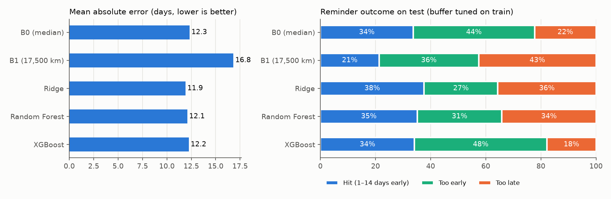

# ML results (Task 2.3b, refreshed in 2.4b)

> Model comparison only. The full evaluation (SHAP, D-038 check, status F1/AUC, reminder window)
> is docs/ml_evaluation.md; where the two overlap they come from the same split and settings.
> 2.4b: feature `n_prior_visits` replaced by `has_history` (D-058); reminder window from configs/ml.yaml.

Generated by `python -m src.ml.train` from `configs/ml.yaml` (seed 42).
Data: **SYNTHETIC** (`data/synthetic/service_records_cleaned.csv`). Same split as docs/ml_baselines.md
(`make_split`: cutoff 2025-08-23; train 1,745 visits / 359 trucks,
test 202 visits / 46 trucks; no truck in both).

## Verdict

**No model clearly beats B0.** The best model (XGBoost) has test MAE 12.2 vs B0 12.3 days; the 95% interval of the gain (-0.79 to +0.93 days) includes 0, so the difference may be noise.

## 1. B1 check: does route km/day include waiting? (brief step 1)

Yes. `route_table` → `formula_days_at_midpoints` adds the middle waiting days (2.5 per round trip) to the middle driving days, exactly like the generator adds waiting to every trip. Checked against the generator itself (its own `draw_trip` / `simulate_interval`, 4,000 trips and 3,000 on-time intervals per destination, no records): per-trip km/day agrees within ~3 % (Beijing 502 formula vs 486 generator), and with route switching (V6) turned off, B1 at 17,500 km equals the generator's median on-time interval (Beijing 35 = 35, Kyakhta 81 = 81). **Not a bug.** The Beijing gap (B1 35 vs actual ~54 days) comes from V6: a truck changes route between oil changes, so every destination drifts toward the fleet average (Beijing 35 → 44, Russian border 82 → 57 with V6 on), plus late visits on top. Official B1 switched to 17,500 km (D-049).

## 2. How the models were chosen (TRAIN only)

- Features: `src/common/features.py` (10 columns; vehicle model and oil grade not used).
  Categories one-hot; numbers median-filled with "was empty" flags (fitted inside each fold).
- RandomizedSearchCV, 25 draws per model, GroupKFold(5) by truck, scored by MAE.
- Validation = out-of-fold predictions on TRAIN (each visit predicted without its truck).
  **Best model = lowest validation MAE → XGBoost.** Test was not looked at for this choice.
- Reminder buffer per model (B0 and B1 too) = days early that maximize the validation hit
  rate (range 0–30 days; ties → fewer late reminders).

| Model | CV MAE (train) | Best hyperparameters |
|---|---|---|
| Ridge | 12.46 | alpha=17.7 |
| Random Forest | 12.46 | max_depth=8, max_features=0.3, min_samples_leaf=19, n_estimators=306 |
| XGBoost | 12.43 | colsample_bytree=0.504, learning_rate=0.0107, max_depth=4, min_child_weight=27, n_estimators=610, reg_lambda=0.19, subsample=0.717 |

Validation (TRAIN, out-of-fold):

| Baseline | Buffer (days early) | RMSE (days) | MAE (days) | R² | Reminder hit rate | Too early | Too late |
|---|---|---|---|---|---|---|---|
| B0 (median) | 12 | 16.4 | 13.1 | -0.01 | 33.0% | 44.0% | 23.0% |
| B1 (17,500 km) | 1 | 20.8 | 16.6 | -0.63 | 28.3% | 31.0% | 40.7% |
| Ridge | 7 | 15.6 | 12.5 | 0.09 | 33.9% | 29.2% | 36.8% |
| Random Forest | 8 | 15.6 | 12.5 | 0.09 | 34.0% | 31.2% | 34.8% |
| XGBoost | 14 | 15.6 | 12.4 | 0.09 | 34.6% | 45.4% | 20.1% |

## 3. Results on the test split (202 visits, 46 trucks)

| Baseline | Buffer (days early) | RMSE (days) | MAE (days) | R² | Reminder hit rate | Too early | Too late | Hit rate, no buffer |
|---|---|---|---|---|---|---|---|---|
| B0 (median) | 12 | 15.7 | 12.3 | -0.00 | 33.7% | 44.1% | 22.3% | 30.7% |
| B1 (17,500 km) | 1 | 20.9 | 16.8 | -0.78 | 21.3% | 36.1% | 42.6% | 22.3% |
| Ridge | 7 | 15.1 | 11.9 | 0.06 | 37.6% | 26.7% | 35.6% | 29.7% |
| Random Forest | 8 | 15.3 | 12.1 | 0.04 | 35.1% | 30.7% | 34.2% | 31.2% |
| XGBoost | 14 | 15.5 | 12.2 | 0.02 | 34.2% | 48.0% | 17.8% | 31.2% |

Hit = reminder arrives 1–14 days before the actual visit (D-036; window D-051, configs/ml.yaml),
sent on predicted day − buffer. "Hit rate, no buffer" = same prediction sent on the predicted day.

**MAE difference vs B0 on test** (positive = better than B0; 95% interval from
2,000 resamples of whole test trucks):

| vs B0 | MAE gain (days) | 95% interval | Clearly better than B0? |
|---|---|---|---|
| B1 (17,500 km) | -4.49 | -6.24 to -2.84 | worse |
| Ridge | +0.42 | -0.21 to +1.01 | no (interval includes 0) |
| Random Forest | +0.23 | -0.46 to +0.90 | no (interval includes 0) |
| XGBoost | +0.07 | -0.79 to +0.93 | no (interval includes 0) |

## 4. Reading

- Best model on validation: **XGBoost** (validation MAE 12.43 vs B0 13.09).
- On this synthetic data the truck's history features are weak (|r| ≤ 0.16, task 2.1),
  so a large gain over a fixed interval was not expected (RISK-13). Per D-050 the generator
  was NOT changed to make ML win; the next step is calibrating it to the real repeat-truck
  intervals (1.4b) and reporting before/after.
- The buffer matters as much as the model for the business metric: compare "Hit rate,
  no buffer" with the tuned column.
- Test has 202 visits from 46 trucks; read small differences with the intervals above.
- Saved: `models/next_change_model.joblib` (git-ignored) = Ridge pipeline (serving model,
  `models.serving_model` in configs/ml.yaml) + its buffer (7 days) + feature list.
  SHAP and the full evaluation: docs/ml_evaluation.md (task 2.4).
