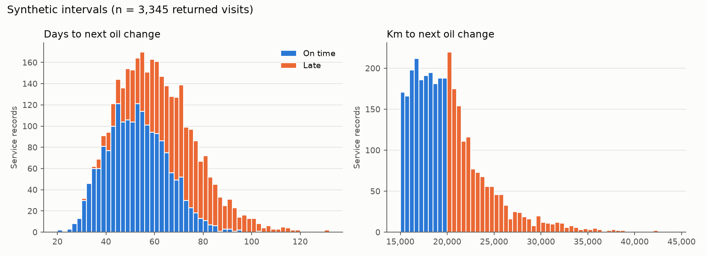

# Synthetic data report (Task 1.3)

Generated by `python -m src.data.generator` from `configs/generator.yaml` (seed 42). Same config + seed → same data and same report.
All numbers below describe SYNTHETIC data built from [ESTIMATE] ranges (docs/synthetic_rules.md); they are not facts about Geo-Expert's customers.

Files (git-ignored): `data/synthetic/service_records_clean.csv` (truth + target), `service_records_dirty.csv` (noise, no truth), `noise_log.csv`.

## 1. Rows and vehicles

| What | Count |
|---|---|
| Service records (clean) | 3,845 |
| Service records (dirty, incl. duplicates) | 3,927 |
| Vehicles | 500 |
| Companies | 121 |
| Records per vehicle (min / median / max) | 1 / 7 / 20 |
| Service dates | 2024-01-02 – 2026-09-30 |
| Training rows (next visit observed) | 3,345 |

## 2. Return behavior

| Outcome | Target (D-031) | Generated |
|---|---|---|
| on_time | 50% | 50.2% |
| late | 40% | 39.3% |
| never | 10% | 10.5% |

Shares are over records whose next step is known. 108 more records are **censored** (the next visit would fall after `end_date`); they have no target, like the newest real records. `never` includes late visits beyond the 60-day maximum (§4).

## 3. Interval distribution

Days and km from one service to the next, for visits that came back.

| Series | n | mean | p5 | p25 | p50 | p75 | p95 |
|---|---|---|---|---|---|---|---|
| All returned | 3,345.0 | 59.6 | 36.0 | 48.0 | 58.0 | 70.0 | 88.0 |
| On time | 1,876.0 | 52.3 | 33.0 | 43.0 | 52.0 | 61.0 | 73.0 |
| Late | 1,469.0 | 68.9 | 45.0 | 58.0 | 68.0 | 79.0 | 96.6 |
| Km (all returned) | 3,345.0 | 20,183.5 | 15,491.6 | 17,236.0 | 19,446.0 | 21,875.0 | 28,091.8 |

**By stated destination** (destination said at the service; the truck may change route afterwards, V6):

| Stated destination | n | median | p25 | p75 | Formula days for 15,000 km (all ranges at middle) |
|---|---|---|---|---|---|
| Altanbulag (MN–RU border) | 523 | 64.0 | 53.0 | 75.0 | 70.1 |
| Beijing | 985 | 51.0 | 41.0 | 62.0 | 29.9 |
| Erenhot (CN side of border) | 700 | 58.0 | 49.0 | 71.0 | 43.9 |
| Kyakhta (RU side of border) | 465 | 63.0 | 53.0 | 74.0 | 69.2 |
| Zamyn-Uud (MN–CN border) | 672 | 60.0 | 50.0 | 71.0 | 44.4 |

**Median days by season of the service:** winter 59, spring 58, summer 56, autumn 59.

Reading: on the short Russian-border routes (~700 km round trip) the 0–5 waiting days per trip take more time than the driving, so the destinations differ less than their km suggest. If real waiting is shorter or longer, this changes a lot (see open items).

Why the formula column is lower than the medians, most of all for long routes: (1) the stated destination fixes only the FIRST trip; with V6 (same destination again with probability 0.7 per trip) a truck usually changes route several times before its next oil change, so every destination's median moves toward the fleet average; (2) the formula uses 15,000 km, while trucks actually drive 15k–20k km and ~40% come late (D-030, D-031). This is the gap between B1 and reality that the ML should learn from history.

## 4. Noise in the dirty file (synthetic_rules §7)

| Rule | Config key | Target | Applied (share of clean records) |
|---|---|---|---|
| N1 | missing_phone | 10% | 10.8% |
| N2 | missing_driver_name | 15% | 14.9% |
| N3 | missing_destination | 10% | 10.7% |
| N4 | missing_odometer | 3% | 3.1% |
| N5 | destination_variant | 20% | 19.8% |
| N6 | plate_latin_lookalike | 5% | 4.6% |
| N7 | plate_spacing | 5% | 5.3% |
| N8 | odometer_digit_error | 1% | 0.7% |
| N9 | odometer_lower_than_last | 1% | 1.0% |
| N10 | phone_format | 10% | 10.8% |
| N11 | duplicate_record | 2% | 2.1% |
| N12 | late_entry | 5% | 4.8% |

N6 is skipped when a plate has no letter with a Latin look-alike, so it lands a little under target. N13 (haul trucks) is not used: road trucks only (D-037 fallback).

## 5. Synthetic vs real

`data/interim/real_intervals.csv` was not found, so there is no comparison yet. To add it: put one row per real visit gap in that file with a column `days_between_visits` (private, git-ignored) and rerun the generator.
